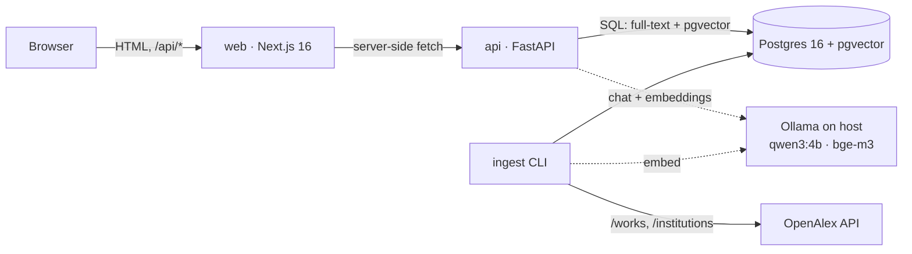

# UIUC Research Portal

A single-page research portal for the University of Illinois Urbana-Champaign, built on two years of OpenAlex data (Nov 2024 – Nov 2026) and a directory of 999 faculty, paired with a local LLM research assistant.


> **Status:** complete: data pipeline, read API, portal and research assistant, all tested. Both required questions are answered with cited sources (see [Research assistant](#research-assistant)).

## Quickstart

Prerequisites: Docker, and [Ollama](https://ollama.com) installed and running on the host (it uses the GPU there).

```bash
git clone https://github.com/qh-fol-in-luv-w-data/uiuc-research-portal.git && cd uiuc-research-portal
docker compose up -d
open http://localhost:3000
```

That's all. Docker pulls three prebuilt images from GitHub Container Registry (amd64 and arm64):

| Image | Contents |
|---|---|
| `uiuc-research-portal-db` | Postgres 16 + pgvector **with the full portal database baked in**, restored automatically on first start |
| `uiuc-research-portal-api` | FastAPI service and the ingest CLI |
| `uiuc-research-portal-web` | Next.js portal |

On first start the database restores itself (a couple of minutes). A one-shot `setup` service then pulls the models into your Ollama if they are missing: `qwen3:4b-instruct-2507` (answers), `bge-m3` (embeddings) and the finetuned `hodacquan2004/uiuc-qu:4b` (query understanding), a one-time download of about 8 GB. If Ollama is not running, the portal still works and the assistant shows as offline. Later runs start in seconds. Follow first-run progress with `docker compose logs -f db setup`.

Build from source instead of pulling: `docker compose build && docker compose up -d`. With an empty database and no dump, `setup` runs the full ingest from OpenAlex (about 40 minutes), which needs the provided `illinois-researchers.csv` in `data/`.

No Ollama on the host? Run a bundled one (CPU only inside Docker on macOS, so slow): `OLLAMA_URL=http://ollama:11434 docker compose --profile ollama up -d`.

Ports: web `3000`, API `8010`, Postgres `55432`. Override any of them, e.g. `WEB_PORT=3100 docker compose up -d`.

## Architecture



- The browser only talks to the Next.js server. Data sections are React Server Components that fetch from the API server-side; client calls to `/api/*` go through a Next.js route handler that proxies to FastAPI. The API address, database and retrieval logic never reach the browser, and production builds ship no source maps.
- Ollama runs on the host because Docker on macOS has no access to the Metal GPU.
- `ingest` is a re-runnable CLI. Every step is idempotent and OpenAlex responses are cached on disk.

| Path | What it is |
|---|---|
| `ingest/` | Pipeline: `fetch-works → clean-works → load-faculty → embed-profiles → link-faculty → embed → aggregate → partners-geo` |
| `apps/api/` | FastAPI read API: `/health`, `/api/overview`, `/api/stats/{key}`, `/api/works`, `/api/faculty`, `/api/faculty/{id}` |
| `apps/web/` | Next.js 16 portal (App Router, Cache Components / partial prerendering, Tailwind 4, motion) |
| `db/migrations/` | Schema: works, authors, authorships, institutions, topics, faculty, links, stats cache |
| `docs/data-quality.md` | Generated data-quality report |
| `docs/superpowers/` | Design spec and implementation plans |

## Data

**OpenAlex.** All works with an authorship at UIUC (`I157725225`) published in the last two years: 26,866 records, fetched with page-number paging over monthly slices. Cursor paging now requires an API key; page paging stops at 10,000 results per query.

**Kept: 23,301 works.** The brief asks for the top 10,000–20,000 papers. Every research paper was kept rather than truncating to 20k, because truncating by citations removes most recent papers, and the assistant must answer "most recent" questions. The rest of the 26,866 are not papers (datasets, conference abstracts, editorials, errata, software, …) or are filtered as described below.

Problems found and fixed during ingest (details in [`docs/data-quality.md`](docs/data-quality.md)):

| Problem | Fix |
|---|---|
| 3,669 UIUC authorships have no author id yet, so 793 genuine UIUC works looked unaffiliated | Affiliation evidence is read from every authorship, attributed or not |
| OpenAlex cuts author lists at 100, hiding the UIUC author in large collaborations | The "no UIUC affiliation" rule is skipped for truncated lists |
| UIUC institutes (NCSA, Carl R. Woese Institute, Prairie Research Institute, …) appeared as top "partners" | OpenAlex child institutions + lineage + a small curated list (`data/uiuc_units.yaml`) count as UIUC |
| Preprint and published versions of one paper counted twice | 337 versions collapsed (same normalized title and a shared author; the published version wins) |
| Old works reissued with a 2025–26 date carry decades of citations (e.g. an older book chapter re-dated 2026 with 1,633 citations) | 65 flagged when most citations predate publication by 2+ years and the first citation is 3+ years earlier (calibrated on all 462 candidates) |
| A Russian-language article with 8,198 citations | Flagged: non-English and in the top 1% by citations |

**Faculty.** The CSV's Postgres-array keywords are parsed and cleaned (stoplist, organisation names). Faculty are matched to OpenAlex authors by tiered name matching (exact → first+last → initial+last). Ambiguous and initial-only matches are checked against topic similarity (bge-m3), and initial-only matches are skipped for very common surnames. **807 of 999 (80.8%)** are linked. A manual check of all 15 initial-tier and 15 random first+last links found the two errors that the topic check and surname rule now prevent.

**Institution.** Facts from OpenAlex. Campus photos are public-domain images from Wikimedia Commons, self-hosted and credited on the page.

## Research assistant

`POST /api/chat` streams Server-Sent Events `plan → sources → token… → done`. The UI shows the search plan, the source cards, then the answer, whose citations link to the cards.

| Step | How | Model |
|---|---|---|
| 1. Understand | Question (+ last turns) → JSON plan: intent, concept groups, date window, sort, limit. JSON schema enforced, `think: false`. Falls back to the chat model with few-shot examples if the finetuned model is missing, and to a rule parser on timeout or an unusable plan | [`hodacquan2004/uiuc-qu:4b`](https://ollama.com/hodacquan2004/uiuc-qu) (Qwen3-4B + LoRA, finetuned for this step, Q4_K_M; `:4b-q8` also published) |
| 2. Retrieve | No LLM. **Papers:** candidates from full-text (works matching every concept group) ∪ nearest works to the question ∪ nearest works to the concepts, fused with reciprocal rank fusion, date window, outliers and duplicate versions removed. **Faculty:** keyword evidence per concept group (core term vs synonym, IDF-weighted, head-noun aware) + profile similarity + related papers, ranked so experts covering every part of the question come first | `bge-m3` embeddings, pgvector |
| 3. Answer | Numbered sources → a short answer that cites only sources actually on topic and says plainly when few match; citations pointing to no source are removed | `qwen3:4b-instruct-2507` |

**Query-understanding benchmark** (held-out questions not used for training, 57 total, `finetune/bench_native.py`, Ollama, schema enforced):

| Model | Valid JSON | Intent | Sort | Dates | Concept recall | p50 latency |
|---|---|---|---|---|---|---|
| `uiuc-qu:4b` finetuned, Q4_K_M (default) | 100% | 94–100% | **97–100%** | 92–97% | 98–100% | 4 s |
| `uiuc-qu:4b-q8` finetuned, Q8_0 | 100% | 92–94% | 100% | 92–97% | 97–100% | 6 s |
| `qwen3:4b` + few-shot | 100% | 94–96% | 58–65% | 85–97% | 98% | 4–5 s |

**Latency.** Three things took a typical answer from 21–23 s to 6–8 s: requantizing the finetuned model from Q8_0 to Q4_K_M (same benchmark scores, 2.5 GB instead of 4.3 GB), small per-model context sizes plus a long keep-alive so Ollama keeps all three models loaded instead of swapping them per request, and a shorter answer prompt (8 sources, 200-character abstracts). A single-model setup (the chat model also planning the search, few-shot) was 2–3 s faster still but planned noticeably worse searches for the required questions, so it is not the default.

The finetuned model is what makes "most recent" / "most cited" questions reliable. Two lessons from building it: the Ollama chat template must match the training prompt (an always-open `<think>` block made the model ramble), and an LLM judge of 4B parameters could not reliably score search results, so the answer step selects relevant sources instead.

**On the required questions:** UIUC has very few recent papers squarely about AI in war; the assistant names the closest ones (AI for children in armed conflict, conflict dynamics from social media) and says so rather than padding the list. For computer vision in healthcare it names faculty such as Jimeng Sun, Viktor Gruev, Minh N Do and Jim Rehg with their matching expertise.

## Front end

The design was mocked up first, then built in Next.js. Motion follows a "data portal" brief: depth in the hero, then animation only where it helps reading numbers.

- Hero with depth layers (grid texture, gradient glows, parallax campus photo), masked line reveal, KPI count-up.
- Research fields as a proportional tile map. Selecting a field filters publications and faculty, and the filter is kept in the URL (`?field=`) so a filtered view can be shared.
- Monthly output chart (plain CSS bars, no chart library); January spikes are explained, and the current month is marked partial.
- Most cited / most recent publications (keyboard-accessible tabs). UIUC faculty authors open their profile.
- Faculty search with a profile drawer (native `<dialog>`: focus trap, Esc, focus return), showing the OpenAlex link confidence.
- Collaboration map (Leaflet, OpenStreetMap, loaded only when near the viewport) and campus card.
- Reveals and word-by-word lighting use CSS scroll-driven animations. Content is visible by default, costs no JavaScript, and `prefers-reduced-motion` is respected throughout.
- Fonts (IBM Plex) are self-hosted, so the build needs no network. Colours were chosen for WCAG AA contrast (not yet audited with a tool), and the page has no horizontal scroll at phone width (tested).

## Tests

```bash
make test   # 63 Python tests (ingest + API) and 9 web unit tests
make e2e    # 8 Playwright end-to-end tests against the running stack (uses the local Chrome)
```

End-to-end coverage includes: every section renders real data with no console errors; the field filter updates the URL and narrows results; tab keyboard navigation; faculty search → drawer → Esc → focus return; the assistant streaming contract (mocked SSE); the offline state; reduced motion; and the phone layout.

## Database dump

The database (≈150 MB compressed, over GitHub's 100 MB file limit) is not in the repository: it ships inside the `uiuc-research-portal-db` image. Maintainers refresh it with `make image-dump && make publish`.

## Known limitations

- If the finetuned model cannot be pulled, the assistant uses the chat model with few-shot examples (weaker on sort, see the benchmark).
- Answers finish in about 6–8 s on an M3 Pro (first words after 3–5 s) when all three models fit in GPU memory (about 7 GB). With less free memory Ollama swaps models between steps and answers take 15–20 s; close other heavy apps or give Ollama more memory. Faculty ranking for broad two-part questions is good but not perfect; the portal's faculty search box is still keyword-only.
- OpenAlex data changes daily; counts in this README are from the 17–18 Nov 2026 ingest.

Not an official University of Illinois site. Data: OpenAlex (CC0); faculty directory provided with the assessment; map © OpenStreetMap contributors.
