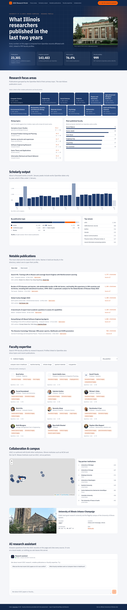
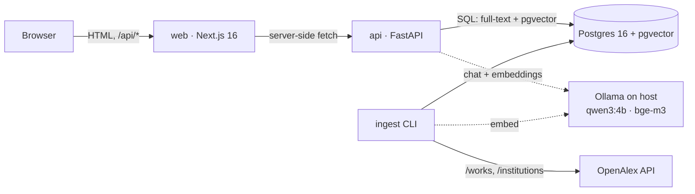

# UIUC Research Portal

A single-page research portal for the University of Illinois Urbana-Champaign, built on two years of OpenAlex data (Nov 2024 – Nov 2026) and a directory of 999 faculty, paired with a local LLM research assistant.



> **Status:** the portal (data pipeline, read API, web) is complete and tested. The assistant UI is built against its streaming contract; the retrieval + generation backend (`POST /api/chat`) is the next milestone.

## Quickstart

Prerequisites: Docker, and [Ollama](https://ollama.com) running on the host with the models pulled:

```bash
ollama pull qwen3:4b && ollama pull bge-m3
```

Then:

```bash
make restore   # load the prebuilt database (db/dump/portal.sql.gz, see "Database dump")
make up        # build and start db, api, web
open http://localhost:3000
```

Ports: web `3000`, API `8010`, Postgres `55432`. Override any of them, e.g. `make up WEB_PORT=3100`.

To rebuild the database from scratch instead of restoring it (about 40 minutes, mostly embeddings), put the provided `illinois-researchers.csv` in `data/` and run `make ingest`.

## Architecture



- The browser only talks to the Next.js server. Data sections are React Server Components that fetch from the API server-side; client calls to `/api/*` go through a Next.js route handler that proxies to FastAPI. The API address, database and retrieval logic never reach the browser, and production builds ship no source maps.
- Ollama runs on the host because Docker on macOS has no access to the Metal GPU.
- `ingest` is a re-runnable CLI. Every step is idempotent and OpenAlex responses are cached on disk.

| Path | What it is |
|---|---|
| `ingest/` | Pipeline: `fetch-works → clean-works → load-faculty → embed-profiles → link-faculty → embed → aggregate → partners-geo` |
| `apps/api/` | FastAPI read API: `/health`, `/api/overview`, `/api/stats/{key}`, `/api/works`, `/api/faculty`, `/api/faculty/{id}` |
| `apps/web/` | Next.js 16 portal (App Router, Cache Components / partial prerendering, Tailwind 4, motion) |
| `db/migrations/` | Schema: works, authors, authorships, institutions, topics, faculty, links, stats cache |
| `docs/data-quality.md` | Generated data-quality report |
| `docs/superpowers/` | Design spec and implementation plans |

## Data

**OpenAlex.** All works with an authorship at UIUC (`I157725225`) published in the last two years: 26,866 records, fetched with page-number paging over monthly slices. Cursor paging now requires an API key; page paging stops at 10,000 results per query.

**Kept: 23,301 works.** The brief asks for the top 10,000–20,000 papers. Every research paper was kept rather than truncating to 20k, because truncating by citations removes most recent papers, and the assistant must answer "most recent" questions. The rest of the 26,866 are not papers (datasets, conference abstracts, editorials, errata, software, …) or are filtered as described below.

Problems found and fixed during ingest (details in [`docs/data-quality.md`](docs/data-quality.md)):

| Problem | Fix |
|---|---|
| 3,669 UIUC authorships have no author id yet, so 793 genuine UIUC works looked unaffiliated | Affiliation evidence is read from every authorship, attributed or not |
| OpenAlex cuts author lists at 100, hiding the UIUC author in large collaborations | The "no UIUC affiliation" rule is skipped for truncated lists |
| UIUC institutes (NCSA, Carl R. Woese Institute, Prairie Research Institute, …) appeared as top "partners" | OpenAlex child institutions + lineage + a small curated list (`data/uiuc_units.yaml`) count as UIUC |
| Preprint and published versions of one paper counted twice | 337 versions collapsed (same normalized title and a shared author; the published version wins) |
| Old works reissued with a 2025–26 date carry decades of citations (e.g. an older book chapter re-dated 2026 with 1,633 citations) | 65 flagged when most citations predate publication by 2+ years and the first citation is 3+ years earlier (calibrated on all 462 candidates) |
| A Russian-language article with 8,198 citations | Flagged: non-English and in the top 1% by citations |

**Faculty.** The CSV's Postgres-array keywords are parsed and cleaned (stoplist, organisation names). Faculty are matched to OpenAlex authors by tiered name matching (exact → first+last → initial+last). Ambiguous and initial-only matches are checked against topic similarity (bge-m3), and initial-only matches are skipped for very common surnames. **807 of 999 (80.8%)** are linked. A manual check of all 15 initial-tier and 15 random first+last links found the two errors that the topic check and surname rule now prevent.

**Institution.** Facts from OpenAlex. Campus photos are public-domain images from Wikimedia Commons, self-hosted and credited on the page.

## Front end

The design was mocked up first, then built in Next.js. Motion follows a "data portal" brief: depth in the hero, then animation only where it helps reading numbers.

- Hero with depth layers (grid texture, gradient glows, parallax campus photo), masked line reveal, KPI count-up.
- Research fields as a proportional tile map. Selecting a field filters publications and faculty, and the filter is kept in the URL (`?field=`) so a filtered view can be shared.
- Monthly output chart (plain CSS bars, no chart library); January spikes are explained, and the current month is marked partial.
- Most cited / most recent publications (keyboard-accessible tabs). UIUC faculty authors open their profile.
- Faculty search with a profile drawer (native `<dialog>`: focus trap, Esc, focus return), showing the OpenAlex link confidence.
- Collaboration map (Leaflet, OpenStreetMap, loaded only when near the viewport) and campus card.
- Reveals and word-by-word lighting use CSS scroll-driven animations. Content is visible by default, costs no JavaScript, and `prefers-reduced-motion` is respected throughout.
- Fonts (IBM Plex) are self-hosted, so the build needs no network. Colours were chosen for WCAG AA contrast (not yet audited with a tool), and the page has no horizontal scroll at phone width (tested).

## Tests

```bash
make test   # 63 Python tests (ingest + API) and 9 web unit tests
make e2e    # 8 Playwright end-to-end tests against the running stack (uses the local Chrome)
```

End-to-end coverage includes: every section renders real data with no console errors; the field filter updates the URL and narrows results; tab keyboard navigation; faculty search → drawer → Esc → focus return; the assistant streaming contract (mocked SSE); the offline state; reduced motion; and the phone layout.

## Database dump

`db/dump/portal.sql.gz` (≈150 MB, over GitHub's 100 MB file limit) is distributed separately, not in the repository. [YOUR RELEASE LINK]

## Known limitations

- **Assistant backend pending.** `POST /api/chat` (query understanding with qwen3, hybrid full-text + vector retrieval with concept-group filtering, cited generation over SSE) is the next milestone. The UI, contract and tests are in place.
- Faculty search is keyword (full-text) only until the hybrid retrieval lands, so broad terms such as "computer" can match loosely.
- OpenAlex data changes daily; counts in this README are from the 17–18 Nov 2026 ingest.

Not an official University of Illinois site. Data: OpenAlex (CC0); faculty directory provided with the assessment; map © OpenStreetMap contributors.
